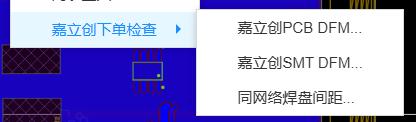
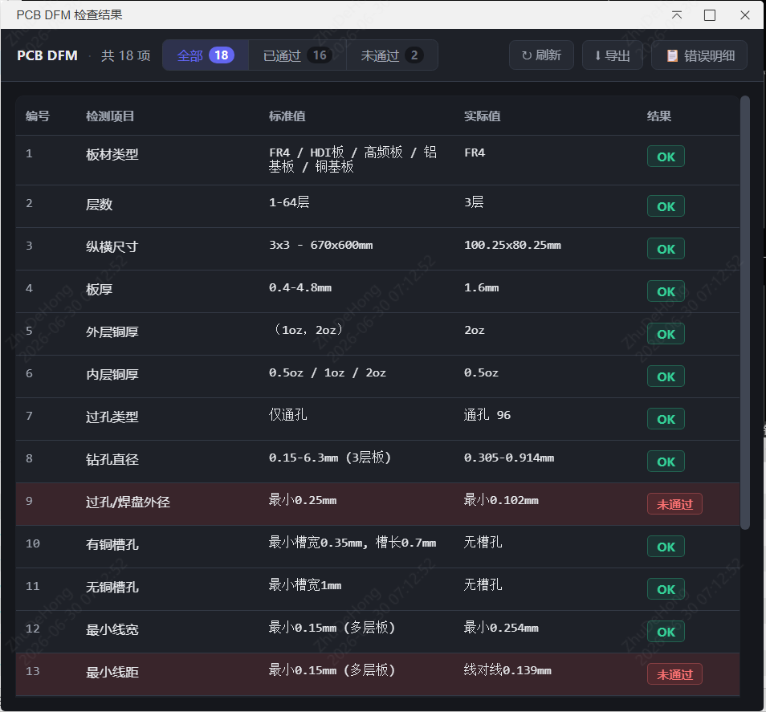
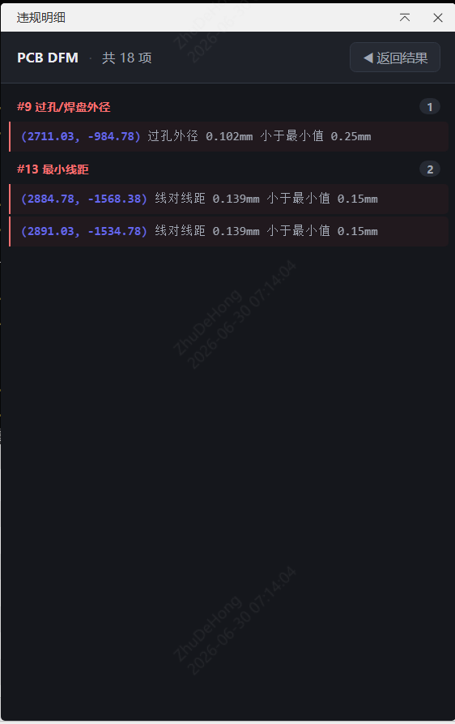
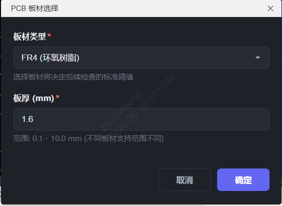
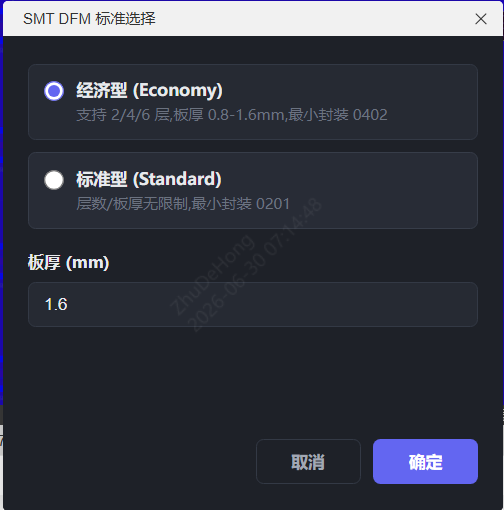
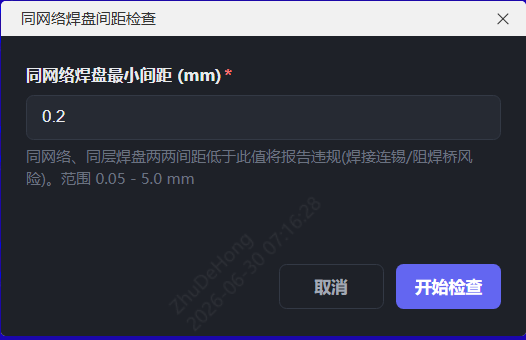

[English](./README.md) | [简体中文](./README.zh-CN.md)

# JLC DFM Checker

> An extension for EasyEDA Pro that checks, in one click, whether a PCB design meets JLC's fabrication process requirements. Violations can be located by clicking and exported as a report.

## Table of Contents

- [At a Glance](#at-a-glance)
- [Overview](#overview)
- [Features](#features)
  - [PCB DFM (18 Checks)](#pcb-dfm-18-checks)
  - [SMT DFM (7 Checks)](#smt-dfm-7-checks)
  - [Same-Net Pad Spacing](#same-net-pad-spacing)
- [Supported Materials](#supported-materials)
- [Usage](#usage)
  - [1. PCB DFM](#1-pcb-dfm)
  - [2. SMT DFM](#2-smt-dfm)
  - [3. Same-Net Pad Spacing](#3-same-net-pad-spacing)
- [Requirements](#requirements)
- [Installation](#installation)
- [Notes](#notes)
- [Feedback & References](#feedback--references)
- [License](#license)

## At a Glance

**Header menu** — the **JLC Order Check** group at the top of the PCB editor expands into three entries:

**PCB DFM results window** — an 18-check results table. The toolbar supports **All / Passed / Failed** filtering, refresh, export, and switching to **Error Details**:

**Error details window** — the narrow window opened by **Error Details**. It shows only violations to reduce obstruction of the canvas; each violation can be clicked to locate it. It can be collapsed at the top-right; click **◀ Back to Results** or close it to return to the main window:

## Overview

**JLC DFM Checker** is built for engineers who design PCBs with EasyEDA Pro. During the design phase it checks the current PCB item by item against **JLC's official fabrication standards**, catching issues early that could cause manufacturing difficulties or rework (trace width / spacing, hole size, annular ring, slot holes, BGA, silkscreen text, etc.). Every violation is reported with its **coordinates + reason**, and can be clicked in the canvas to locate and highlight the corresponding element for quick correction.

- **Coverage**: **18** PCB DFM checks + **7** SMT DFM checks + same-net pad spacing check.
- **Authoritative standards**: thresholds come from JLC's official process parameters and are matched automatically by material, layer count, and copper weight — **no manual process parameters required**.
- **Less obstruction**: the main results window shows only the summary table; violations are viewed in a separate narrow details window instead of squeezing the canvas.
- **Precise locating**: violations record the primitive ID and coordinates; clicking a detail selects and zooms to the corresponding element.
- **Exportable results**: export a `.txt` report in one click.

## Features

### PCB DFM (18 Checks)

| Category | Checks |
|----------|--------|
| Basic information | Material type, layer count, width/height, board thickness, outer copper weight, inner copper weight, via type (through-hole / blind / buried identified separately) |
| Vias and slots | Drill diameter (vias + pads), via / pad outer diameter, plated slot holes, non-plated slot holes |
| Traces and spacing | Minimum trace width, minimum trace spacing, pad / via-to-trace spacing, plated through-hole pad annular ring, non-plated through-hole pad annular ring |
| Special components and silkscreen | BGA pads, silkscreen text |

> - Blind and buried vias are distinguished separately (working around the editor enum that merges the two).
> - Pad-to-trace distance is calculated precisely using the true rotation of rectangular pads, and same-net elements (including copper pour thermal connections) are skipped automatically to avoid false positives.

### SMT DFM (7 Checks)

Choose the **Economic** or **Standard** grade before running. The following are checked in order: solder side, layer count, board thickness, width/height, minimum package (Economic: 0402 min / Standard: 0201 min), minimum IC pin pitch, BGA ball diameter/spacing.

### Same-Net Pad Spacing

A standalone menu entry: manually set the minimum spacing (mm) and check whether the pairwise spacing between pads on the same net meets the requirement.

## Supported Materials

Standards come from JLC's official process parameters; some parameters are matched in tiers by layer count / copper weight automatically:

| Material | Layers | Available thickness |
|----------|--------|---------------------|
| FR4 | 1–64 | 0.4–4.8 mm (blind/buried vias supported, blind and buried distinguished) |
| HDI board | 4–32 | 0.5–2.4 mm (blind vias 0.075–0.15 / buried vias 0.15–0.55) |
| High-frequency board | 2 | 0.51 / 0.76 / 1.52 mm |
| Aluminum board | 1 | 0.8 / 1.0 / 1.2 / 1.6 mm |
| Copper-based board | 2 | 1.0 / 1.2 / 1.6 mm |

> For example, FR4's maximum dimensions are split into 4 tiers by layer count, and minimum trace width / spacing into 7 tiers by outer copper weight (1 oz 0.10 mm → 6 oz 0.45 mm). The tool automatically selects the thresholds that apply to your board.

## Usage

The tool is available under the **JLC Order Check** group in the **PCB editor** header menu, with three entries.

> Menu screenshot: 

### 1. PCB DFM

1. Open the board to be checked in the PCB editor and click **JLC Order Check → JLC PCB DFM…**.
2. In the **Material Type / Board Thickness** dialog, select the material, enter the board thickness, and confirm.

   > 

3. The tool automatically collects primitives, parses the design file (copper weight, blind/buried via rules), and runs the 18 checks.
4. When finished, a summary is printed in the bottom log panel, and the **results window** opens, listing **No. / Check Item / Standard / Actual / Result** for each check (Result: Failed / Warning / OK).

   > 

5. Toolbar at the top of the results window:
   - **All / Passed / Failed** segmented filter;
   - **Refresh** re-runs in place on the latest data (without reopening the window);
   - **Export** generates a `.txt` report in one click;
   - **Error Details** switches to the separate narrow details window.
6. Click **Error Details** → the main window is hidden and the **narrow details window** opens (violations only, grouped by check), reducing obstruction of the canvas. It can be collapsed at the top-right; click **◀ Back to Results** or close it to return to the main window.

   > 

7. Click a violation in the details list → the corresponding element is selected and zoomed to on the canvas for quick correction.

### 2. SMT DFM

1. Click **JLC Order Check → JLC SMT DFM…**.
2. In the dialog, select **Economic** or **Standard** and confirm.

   > 

3. The 7 checks run and the results are shown in the same results window, with the same interactions as PCB DFM (filter / error details / export / click to locate).

### 3. Same-Net Pad Spacing

1. Click **JLC Order Check → Same-Net Pad Spacing…**.
2. In the dialog, enter the minimum spacing (mm) and confirm.

   > 

3. The check runs and violations are shown in the results window.

## Requirements

- EasyEDA Pro **V3** or later (`engines.eda: ^3.0.0`).
- Must be used inside the **PCB editor** (the schematic editor is not supported).

## Installation

1. Obtain the extension package `.eext` (generated by `npm run build` during development; the file name starts with `jlc-order-dfm-checker`).
2. In EasyEDA Pro: **top menu → Advanced → Extension Manager → Import**, then select the `.eext` file to install.
3. Open the PCB editor and the **JLC Order Check** menu appears in the header.

## Notes

- **Fixed standards**: this tool only checks against JLC's official process parameters and does not support custom process parameters.
- **Material / thickness**: the editor API does not expose material and board thickness, so these two are selected / entered by the user in the dialog; outer / inner copper weight and via types are parsed automatically from the design file and need no manual input.
- **Results window interaction**: the main window shows only the summary table, while violations live in the **Error Details** narrow window (collapsible, can return). Details and summary are deliberately split into separate windows to reduce canvas obstruction.
- **Updating the extension**: after developing or updating the extension, **re-import** the `.eext` in the Extension Manager (or restart EasyEDA) for the new code to take effect; the extension cannot hot-reload at runtime.
- **Read-only**: the tool only reads and analyzes design data and never modifies your PCB / schematic.

## Feedback & References

- JLC process parameters: <https://www.jlc.com/portal/vtechnology.html>
- EasyEDA Pro: <https://pro.easyeda.com/>
- EasyEDA Pro extension development docs: <https://prodocs.easyeda.com/en/api/guide/>

## License

[Apache License 2.0](./LICENSE)
